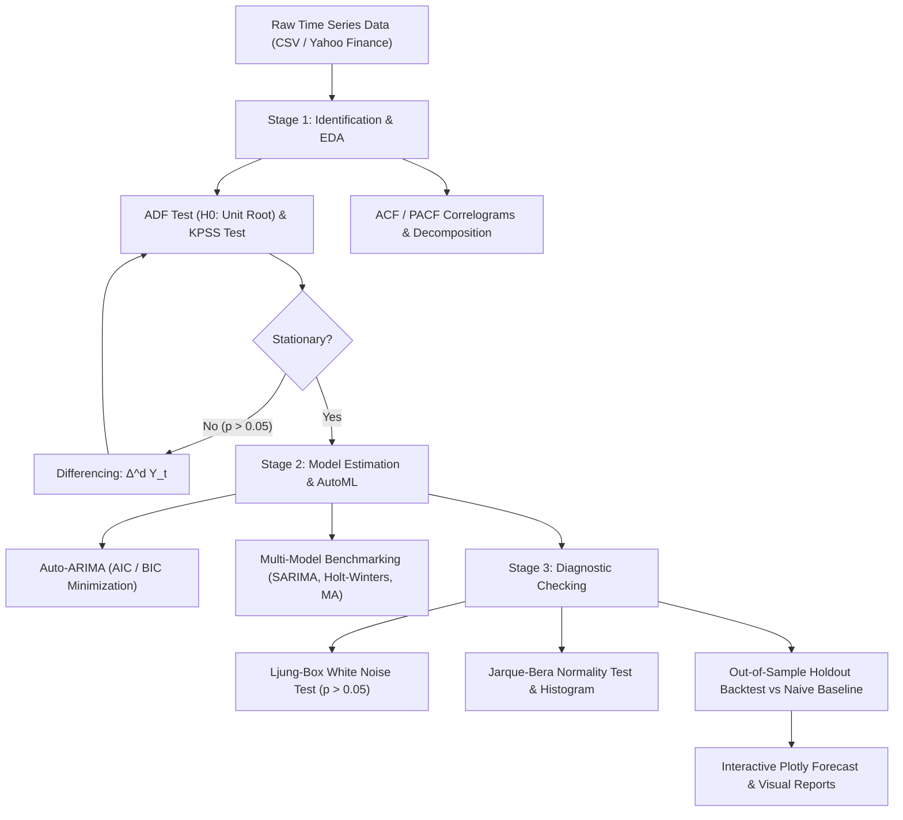

# 🎯 ATSA Playground: Interactive Time Series Analysis Platform


An comprehensive interactive web application for learning and experimenting with Applied Time Series Analysis (ATSA). Perfect for students, data scientists, and analysts who want to understand and apply time series forecasting methods through hands-on experimentation.

## 🏗️ System Architecture & Box-Jenkins Pipeline



## 🌟 Key Features

### 📚 Comprehensive Learning Modules
- **Time Series Fundamentals**: Stationarity, trends, seasonality with interactive examples
- **ARIMA Models**: Complete mathematical framework with practical implementations
- **SARIMA Models**: Advanced seasonal modeling with business case studies  
- **Holt-Winters**: Exponential smoothing methods with real-world applications
- **Prophet**: Facebook's modern forecasting framework with practical examples
- **LSTM Networks**: Deep learning approaches to time series (Coming Soon)

### 📊 Interactive Data Analysis
- Upload CSV/Excel files or explore built-in sample datasets
- Real-time data preprocessing and validation
- Interactive time series visualization with zoom, pan, and annotation
- Automatic seasonal decomposition with animated explanations
- ACF/PACF plots with interpretive guidance

### 🤖 Advanced Modeling Capabilities
- **ARIMA/SARIMA**: Automated parameter selection with grid search
- **Holt-Winters**: Multiple seasonality patterns and trend damping
- **Prophet**: Automatic changepoint detection and holiday effects
- **Model Comparison**: Side-by-side performance metrics and diagnostics
- **Cross-Validation**: Time series specific validation methods
- **Forecast Visualization**: Interactive charts with confidence intervals

### 🎨 Modern User Experience
- Clean, intuitive interface with neumorphic design elements
- Light/dark theme toggle with system preference detection
- Smooth animations and micro-interactions
- Responsive three-panel layout optimizing workflow
- Real-time model fitting with progress indicators

## 🛠️ Tech Stack

### Frontend
- React 18 with TypeScript
- Tailwind CSS for styling
- Plotly.js for interactive charts
- Framer Motion for animations
- React Query for state management

### Backend
- FastAPI (Python)
- Time series libraries: statsmodels, prophet, scikit-learn, tensorflow
- Data processing: pandas, numpy
- Statistical analysis: scipy

## 🚀 Quick Start Guide

### 📋 Prerequisites

Before you begin, ensure you have the following installed on your system:

- **Node.js** (v16 or higher) - [Download here](https://nodejs.org/)
- **Python** (3.8 or higher) - [Download here](https://www.python.org/)
- **Git** - [Download here](https://git-scm.com/)

### 💻 Installation

#### Option 1: Automated Setup (Recommended)

1. **Clone the repository**
```bash
git clone https://github.com/yourusername/atsa-playground.git
cd atsa-playground
```

2. **Run the automated setup script**

**Windows:**
```bash
setup.bat
```

**macOS/Linux:**
```bash
chmod +x setup.sh
./setup.sh
```

The setup script will:
- Create Python virtual environment
- Install all backend dependencies
- Install frontend dependencies
- Set up sample data
- Start both servers automatically

#### Option 2: Manual Setup

1. **Clone and navigate to the project**
```bash
git clone https://github.com/yourusername/atsa-playground.git
cd atsa-playground
```

2. **Backend Setup**
```bash
cd backend

# Create virtual environment
python -m venv venv

# Activate virtual environment
# On Windows:
venv\Scripts\activate
# On macOS/Linux:
source venv/bin/activate

# Install dependencies
pip install -r requirements.txt
```

3. **Frontend Setup**
```bash
cd ../frontend

# Install dependencies
npm install

# Or using yarn:
yarn install
```

4. **Start the Application**

**Terminal 1 - Backend Server:**
```bash
cd backend
# Activate virtual environment if not already active
# Windows: venv\Scripts\activate
# macOS/Linux: source venv/bin/activate

python main.py
```

**Terminal 2 - Frontend Server:**
```bash
cd frontend
npm run dev
```

### 🌐 Access the Application

Once both servers are running:

- **Frontend**: Open [http://localhost:3000](http://localhost:3000) in your browser
- **Backend API**: Available at [http://localhost:8000](http://localhost:8000)
- **API Documentation**: Visit [http://localhost:8000/api/docs](http://localhost:8000/api/docs) for interactive API docs

### 🔧 Troubleshooting

**Common Issues:**

1. **Port Already in Use**
   - Change ports in `backend/main.py` (line ~75) and `frontend/vite.config.ts`
   
2. **Python Dependencies Issues**
   ```bash
   pip install --upgrade pip
   pip install -r requirements.txt --force-reinstall
   ```

3. **Node.js Dependencies Issues**
   ```bash
   rm -rf node_modules package-lock.json
   npm install
   ```

4. **Permission Issues (macOS/Linux)**
   ```bash
   sudo chown -R $(whoami) ~/.npm
   ```

## 📖 Usage Guide

### 🎓 Learning Modules

Navigate through comprehensive learning modules covering:

1. **Time Series Fundamentals** (60 mins)
   - Stationarity concepts and testing
   - Trend and seasonality identification
   - ACF/PACF interpretation

2. **ARIMA Models** (75 mins)
   - Mathematical framework
   - Parameter identification
   - Model diagnostics and validation

3. **SARIMA Models** (75 mins)
   - Seasonal patterns
   - Advanced parameter selection
   - Business case studies

4. **Holt-Winters Exponential Smoothing** (70 mins)
   - Triple exponential smoothing
   - Additive vs multiplicative seasonality
   - ETS framework

5. **Prophet Framework** (85 mins)
   - Facebook's Prophet implementation
   - Holiday effects and changepoints
   - Uncertainty quantification

### 📊 Data Analysis Workflow

1. **Data Upload**: Support for CSV, Excel files with automatic validation
2. **Exploration**: Interactive plots, statistical summaries, pattern detection
3. **Preprocessing**: Handle missing values, outliers, and frequency conversion
4. **Modeling**: Choose from multiple algorithms with guided parameter selection
5. **Evaluation**: Cross-validation, residual analysis, forecast accuracy metrics
6. **Export**: Download models, forecasts, and detailed reports

### 🔧 API Reference

The backend provides RESTful APIs for all functionality:

- **Health Check**: `GET /api/health`
- **Data Operations**: `POST /api/data/upload`, `GET /api/data/samples`
- **Model Training**: `POST /api/models/fit`
- **Forecasting**: `POST /api/models/forecast`
- **Learning Content**: `GET /api/learning/modules`

Full API documentation is available at `/api/docs` when the backend is running.

## 📁 Project Structure

```
atsa-playground/
├── 📁 backend/                  # FastAPI Python backend
│   ├── 📁 app/
│   │   ├── 📁 routers/         # API route handlers
│   │   ├── 📁 models/          # Time series models
│   │   ├── 📁 services/        # Business logic
│   │   ├── 📁 data/            # Learning content & sample data
│   │   └── 📁 utils/           # Utilities and configuration
│   ├── 📄 main.py              # FastAPI application
│   ├── 📄 requirements.txt     # Python dependencies
│   └── 📁 venv/                # Virtual environment (created by setup)
│
├── 📁 frontend/                 # React TypeScript frontend
│   ├── 📁 src/
│   │   ├── 📁 components/      # React components
│   │   ├── 📁 pages/           # Page components
│   │   ├── 📁 services/        # API communication
│   │   ├── 📁 hooks/           # Custom React hooks
│   │   └── 📁 utils/           # Frontend utilities
│   ├── 📄 package.json         # Node.js dependencies
│   ├── 📄 vite.config.ts       # Vite configuration
│   └── 📁 node_modules/        # Dependencies (created by setup)
│
├── 📁 sample_data/              # Sample datasets for experimentation
├── 📄 README.md                 # This file
├── 📄 setup.bat                 # Windows setup script
├── 📄 setup.sh                  # macOS/Linux setup script
├── 📄 .gitignore               # Git ignore rules
└── 📄 LICENSE                   # Project license
```

## 🤝 Contributing

We welcome contributions! Here's how to get started:

### Development Setup

1. Fork the repository
2. Create a feature branch: `git checkout -b feature/amazing-feature`
3. Make your changes following our coding standards
4. Add tests for new functionality
5. Ensure all tests pass: `npm test` (frontend) and `pytest` (backend)
6. Commit your changes: `git commit -m 'Add amazing feature'`
7. Push to your branch: `git push origin feature/amazing-feature`
8. Open a Pull Request

### Code Style

- **Python**: Follow PEP 8, use type hints, add docstrings
- **TypeScript/React**: Use ESLint configuration, prefer functional components
- **Commits**: Use conventional commits format

### Testing

- Backend: `pytest backend/tests/`
- Frontend: `npm test` in frontend directory
- Integration: `npm run test:e2e`

## 📊 Educational Content

This project includes comprehensive educational materials:

- **70+ Interactive Examples**: Hands-on demonstrations of concepts
- **5 Complete Case Studies**: Real-world business applications
- **Mathematical Foundations**: Detailed equations and statistical theory
- **Code Implementations**: Complete, runnable examples in Python
- **Quizzes and Assessments**: Test your understanding

## 🚀 Deployment

### Local Development
Use the setup scripts provided for local development.

### Production Deployment

**Backend (FastAPI)**:
```bash
pip install gunicorn
gunicorn backend.main:app --host 0.0.0.0 --port 8000
```

**Frontend (React)**:
```bash
cd frontend
npm run build
# Serve the dist/ directory with any static file server
```

**Docker Support** (Coming Soon):
```bash
docker-compose up
```

## 📄 License

This project is licensed under the MIT License - see the [LICENSE](LICENSE) file for details.

## 🙏 Acknowledgments

- **Statistical Libraries**: Built on statsmodels, Prophet, and scikit-learn
- **UI/UX**: Inspired by modern data science tools and educational platforms
- **Time Series Theory**: Based on established econometric and statistical methods
- **Open Source Community**: Thanks to all contributors and maintainers

## 🆘 Support

- **📚 Documentation**: Comprehensive guides available in the app
- **🐛 Bug Reports**: Open an issue on GitHub
- **💡 Feature Requests**: Discuss in GitHub Discussions
- **📧 Contact**: [your-email@example.com]

## 🔮 Roadmap

### Version 2.0 (Planned)
- [ ] LSTM and Neural Network models
- [ ] Real-time data streaming
- [ ] Advanced ensemble methods
- [ ] Multi-step ahead forecasting
- [ ] Model interpretability tools
- [ ] Collaborative workspaces

### Version 1.1 (Current)
- [x] Prophet integration
- [x] Interactive learning modules
- [x] Comprehensive documentation
- [x] Cross-platform setup scripts

---

**Made with ❤️ for the time series analysis community**
pip install -r requirements.txt
```

4. Start the development servers

Frontend:
```bash
cd frontend
npm run dev
```

Backend:
```bash
cd backend
uvicorn main:app --reload --host 0.0.0.0 --port 8000
```

5. Open your browser and navigate to `http://localhost:3000`

## 📁 Project Structure

```
atsa-playground/
├── frontend/                 # React application
│   ├── src/
│   │   ├── components/      # Reusable UI components
│   │   ├── pages/           # Main application pages
│   │   ├── hooks/           # Custom React hooks
│   │   ├── utils/           # Utility functions
│   │   ├── types/           # TypeScript type definitions
│   │   └── styles/          # CSS and styling files
├── backend/                 # FastAPI application
│   ├── app/
│   │   ├── models/          # Time series models
│   │   ├── services/        # Business logic
│   │   ├── routers/         # API endpoints
│   │   └── utils/           # Utility functions
├── sample_data/             # Sample datasets
└── docs/                    # Documentation
```

## 🎓 Educational Content

The application covers comprehensive ATSA topics:

### Basics
- Time series components (trend, seasonality, noise)
- Stationarity and transformations
- Autocorrelation and partial autocorrelation

### Modeling
- ARIMA model family
- Exponential smoothing methods
- Prophet decomposition
- Neural network approaches

### Advanced Topics
- Multivariate time series (VAR)
- Volatility modeling (GARCH)
- Forecast evaluation metrics
- Cross-validation techniques

## 🤝 Contributing

Contributions are welcome! Please feel free to submit a Pull Request.

## 📄 License

This project is licensed under the MIT License - see the LICENSE file for details.